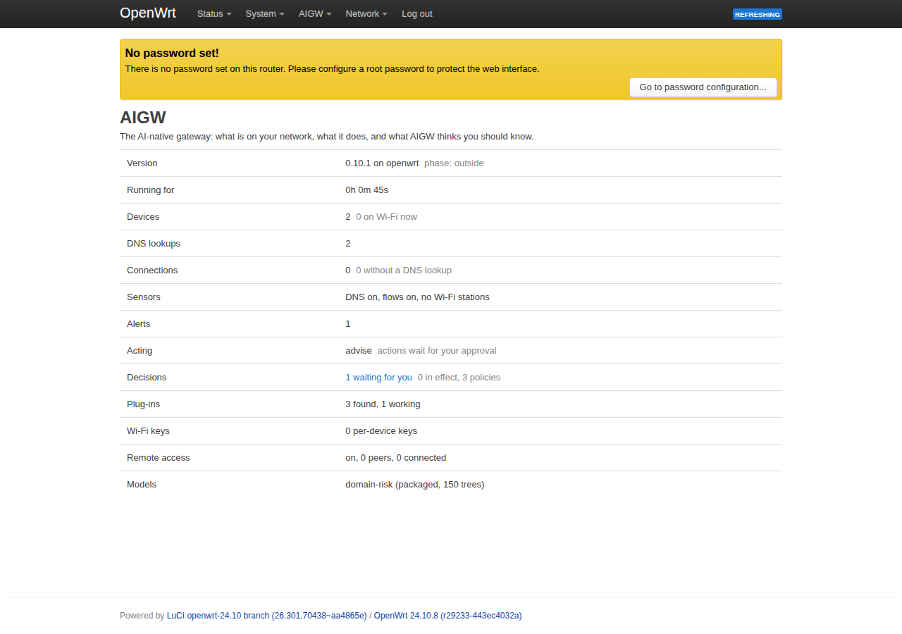
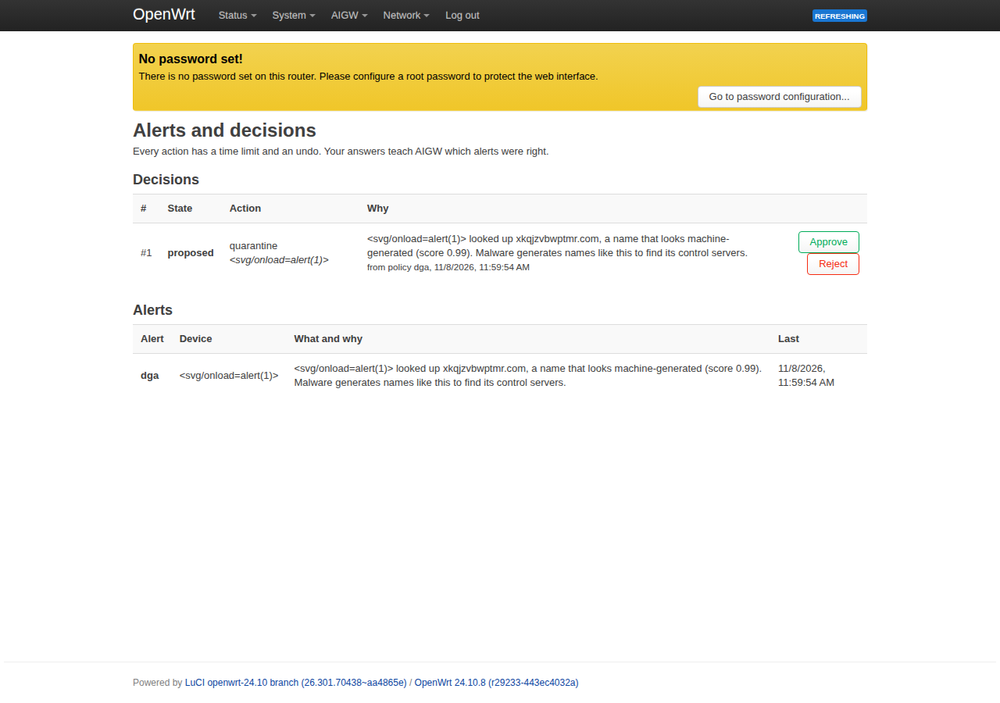

<h1 align="center">
  <picture>
    <source media="(prefers-color-scheme: dark)" srcset="docs/brand/logo-dark.svg">
    
  </picture>
</h1>

<h3 align="center">The AI-powered operating system for home gateways.</h3>

<p align="center">
  <a href="https://github.com/sudeepksingh/aigw/actions/workflows/ci.yml"></a>
  <a href="https://github.com/sudeepksingh/aigw/releases/latest"></a>
  <a href="LICENSE"></a>
  
  
</p>

<p align="center">
  <b>On-device AI</b> · <b>Every device understood</b> · <b>Threats stopped at home</b> · <b>Private by design</b> · <b>Open source</b>
</p>

<p align="center">
  <a href="docs/getting-started-openwrt.md">Get started on OpenWRT</a> ·
  <a href="docs/getting-started-pc-ap.md">Get started on a PC</a> ·
  <a href="docs/ARCHITECTURE.md">Architecture</a> ·
  <a href="https://github.com/sudeepksingh/aigw/releases/latest">Download</a> ·
  <a href="CONTRIBUTING.md">Contribute</a>
</p>

---

AIGW OS is a small AI core that turns an **OpenWRT router**, or **any Linux PC
acting as a Wi-Fi access point**, into a gateway that knows which devices are
on the network, what each one does and what is normal, and acts on it.
Everything runs on the gateway itself. Cloud services are optional, and
everything around the core is a plug-in.

- C core, under 1 MB, built for 128 MB routers
- The same code, API and plug-ins on OpenWRT and on a PC acting as AP
- Fail-open: if AIGW OS stops, your network keeps working

Packages, commands and paths keep the short name `aigw` (`opkg install aigw`,
`/etc/config/aigw`); the daemons are `agd` and `agdns`, the command line `agctl`.

Read the design: [docs/ARCHITECTURE.md](docs/ARCHITECTURE.md) · or open
[docs/architecture.html](docs/architecture.html) in a browser for the
illustrated version.

> **v0.24:** **AIGW Self-Healing Wi-Fi, part 1: the gateway knows why Wi-Fi is
> slow.** AIGW measures what each device in use actually feels (loss and delay,
> not what the radio claims), learns the home's normal, and names the cause:
> a busy channel, weak coverage, a device hopping between bands, one device, or
> the radio. It tells the home in plain words, and the ISP's help desk over
> USP / TR-069 (`Device.X_AIGW_.WiFiHealth`), before anyone calls. It works on
> any radio. On the PC access point it found, by itself, the weak coverage we
> had traced by hand. Part 2 fixes what is safe to fix.
> [docs/self-healing-wifi.md](docs/self-healing-wifi.md)
>
> **v0.23:** **a native prplOS component.** `aigw-amx` publishes AIGW OS's data
> model (alerts, decisions, mode, commands, events) on prplOS's bus as an
> Ambiorix component. prplOS's own USP agent, TR-069 client, CLI and web UI see
> it like any other part of the device, and the home's rules still apply. It is
> tested in CI with Ambiorix itself.
>
> **v0.22:** **ready for a carrier network.** A real firmware upgrade from an ACS
> is now tested on OpenWRT itself (in QEMU): icwmp downloads the image, AIGW checks
> it, `sysupgrade` writes it, and after the reboot the ACS gets its
> TransferComplete. Gateways can present TLS client certificates to the USP
> broker and the ACS. `Reboot` and `FactoryReset` now really reboot and reset
> (USP, and TR-069 on OpenWRT), and the home decides whether an ISP may
> (`mgmt.reset`).
>
> **v0.21:** **what an ISP does first: firmware upgrades and Wi-Fi settings.**
> Over USP or TR-069, an ISP can now change the Wi-Fi name, passphrase,
> security mode (WPA2/WPA3), channel and width, and upgrade the firmware
> (download, check, activate, reboot, report back). Both use the standard TR-181
> parameters and commands. The work itself is done by small handler programs:
> OpenWRT's `uci`/`wifi` and `sysupgrade` by default, or an OEM's own for A/B
> flash or its own Wi-Fi stack.
>
> **v0.20:** **your names, not ours.** An ISP or OEM ships AIGW OS under its own
> TR-106 vendor prefix (`X_<OUI>_` or `X_<DOMAIN>_` in place of `X_AIGW_`) and its
> own manufacturer, model and product class: one setting each, followed by USP,
> TR-069 and the published data model file alike.
>
> **v0.19:** **managed over TR-069 too**, the protocol most ISPs' ACSs still
> speak. iopsys's icwmp client runs unmodified, and a small AIGW daemon serves it
> the same data model USP controllers get. An ACS sees the same devices, approves
> decisions, quarantines or blocks (as `SetParameterValues`, since CWMP has no
> commands), and gets alerts as active notifications. One data layer serves both
> protocols, so the home's rules apply alike, and both can run side by side.
>
> **v0.18:** **managed by your ISP over USP (TR-369)**, the protocol operators
> use for prplOS and RDK-B gateways. The ISP's USP controller talks to the
> Broadband Forum's own OB-USP-Agent, which serves AIGW OS's data model through
> a plug-in. The ISP sees devices, alerts and decisions, approves AIGW OS's
> proposals, and gets alerts as USP events. How much it may do, and see, is the
> home's choice, and the guardrails always hold.
>
> **v0.17:** malware hunting for its control server is caught by **behaviour**,
> whatever its generated names look like. AIGW remembers every site that works
> for anyone in the home; a device whose lookups of names nobody here ever used
> keep getting "no such name" raises `dga-burst`, and the one name that finally
> answers is named as the likely control server. The name model passes 87% of
> pronounceable generated names and every dictionary-word one; this signal
> doesn't read the names at all.
>
> **v0.16.2:** the project is now **AIGW OS**, with its own logo, also in the
> router's web interface. The flow sensor no longer misses a new connection's
> "no DNS lookup" check when its counter refresh sees the connection first.
>
> **v0.16.1:** the domain-risk model is retrained so a machine-generated name
> can't hide behind `www.` or any other subdomain (the old model caught none of
> those; the new one catches them as often as bare names, with the same false
> alarms).
>
> **Status: v0.16, phase 7 "advanced" done in code:** **model back-ends** (a
> router's NPU, DSP or a faster library can compute AIGW's model through one
> small C interface, used only after it gives the reference's verdicts on 300
> probes; a built-in faster CPU back-end gives identical scores; see
> [docs/model-backends.md](docs/model-backends.md)). v0.15 brought a **fast path** (established
> connections of devices AIGW isn't acting on go through the kernel's
> flowtable, or the switch chip on routers that have one, while devices under
> an action stay on the rules) and an **eBPF traffic meter** (each device's
> live rate, counted in the kernel, also for fast-path traffic; no BPF compiler
> needed to build it). v0.14 brought **federated learning**
> (your answers to alerts improve the domain-risk judgement in every home
> while the names stay in yours: each gateway trains on its own answers and
> sends cortex only 14 clipped, noisy numbers; cortex averages the homes and
> publishes a signed layer that each gateway checks before using it).
> v0.13 brought **channel self-healing**
> (an access point whose channel stays crowded is moved to a quieter one, the
> devices following without dropping; proposed for your approval, or automatic
> in enforce mode). v0.12 brought **band steering** (a
> 2.4 GHz and a 5 GHz access point with one name, on a dual-band router or on
> a PC with two adapters; close devices move to 5 GHz, far ones to 2.4 GHz,
> by 802.11v where they support it) and **presence** (who is home, arrivals
> and departures). v0.11 brought DNS answers from a cache
> (about 150× faster than asking upstream, refreshed before they expire,
> still answered when the upstream fails), and every HTTPS connection named
> from its TLS or QUIC handshake, so apps that skip AIGW's DNS (DNS over
> HTTPS, hard-coded addresses) are still seen and judged. Phase 6 brought a
> LuCI web interface, procd supervision, a self-test, and every build checked
> on OpenWRT in QEMU; real routers next. AIGW knows every device (identity, Wi-Fi,
> lookups, connections, traffic), learns what is normal for each one, and
> runs an on-device AI model that recognises machine-generated names used by
> malware. It explains in plain words what deserves attention and can act on
> it: quarantine, prioritise, throttle, block. Every action has a time limit
> and an undo, guardrails that nothing can override, and by default **nothing
> changes until you approve it**. Plug-ins wire themselves in with no
> configuration; every device can have its own Wi-Fi key; Home Assistant sees
> it all. With **cortex**, the optional services outside, your answers to
> AIGW's alerts **retrain the model**, which is **signed and loaded by the
> gateways without a restart**, and you can **ask your home from an AI
> assistant (MCP)**, which can only *suggest* actions. New in v0.9: **remote
> access** (WireGuard, a QR code per phone, AIGW protection away from home),
> **shared threat intelligence** (a threat confirmed in one home protects all)
> and **signed plug-ins**.
> See the [roadmap](docs/ARCHITECTURE.md#16-roadmap).

---

## Quick start: PC as AP

You need a Debian/Ubuntu PC (WSL2 works), an internet connection on Ethernet
or another adapter, and a Wi-Fi adapter that supports AP mode (most USB
adapters with Realtek rtw88 or MediaTek mt76 chips do).

```bash
git clone https://github.com/sudeepksingh/aigw.git
cd aigw
sudo ./install.sh
sudo aigw-ap up
```

The installer prints the Wi-Fi name and password. Join it from a phone, then:

```bash
agctl devices          # every device: type, Wi-Fi signal, lookups, traffic
agctl device <name>    # one device in detail
agctl flows            # recent connections, with the name each one belongs to
agctl dns cache        # how much the DNS cache saves
agctl wifi             # access points, who is on which band
agctl alerts           # what AIGW thinks you should know, and why
agctl decisions        # actions AIGW proposes, and the ones in effect
agctl score <domain>   # ask the domain-risk model about any name
agctl watch all        # DNS, connections, Wi-Fi joins, alerts and decisions, live
```

**On Windows (WSL2):** install inside WSL as above, then start everything from
Windows with `platform\pc-ap\wsl\aigw-wsl.cmd`. It hands the USB adapter to
WSL and brings the access point up.

Full guide: [docs/getting-started-pc-ap.md](docs/getting-started-pc-ap.md)

## Quick start: OpenWRT router

OpenWRT 23.05 or newer. Build the package for your router's CPU (on any Linux
PC, takes about 10 minutes the first time):

```bash
git clone https://github.com/sudeepksingh/aigw.git
cd aigw
TARGET=mediatek/filogic platform/openwrt/build-sdk.sh   # your router's target
```

Copy the package to the router and install it:

```bash
scp dist/openwrt/*/*/aigw* root@192.168.1.1:/tmp/
ssh root@192.168.1.1 'opkg install /tmp/aigw_*.ipk && /etc/init.d/aigw enable && /etc/init.d/aigw start'
```

On OpenWRT 25.12 and newer use `apk add --allow-untrusted /tmp/aigw-*.apk`.

Full guide: [docs/getting-started-openwrt.md](docs/getting-started-openwrt.md)

## On-device AI

The domain-risk model (`models/domain-risk.agm`, 52 KB, 150 small decision
trees) runs inside `agd` through a tiny C interpreter. No ML framework is
needed on the router. It is trained by
[`cortex/training/domain_risk/train.py`](cortex/training/domain_risk/train.py)
on popular sites (Tranco list) and synthetic machine-generated names.

| Held-out test, alert at score >= 0.98 | |
|---|---|
| False alarms on popular sites | 0.15% |
| Generated names caught, per name | 68% overall (hex 93%, base32 99.6%, random letters 67%, pronounceable 13%, dictionary words 0%) |

Malware using a name generator looks up dozens of such names, so an infected
device is flagged quickly even though single names can slip through.
Pronounceable and dictionary-word generators are the name model's weak spot
(it flags 13% and 0% of them), so a second signal looks at behaviour instead:

| Alert | When |
|-------|------|
| `dga-burst` | Within 10 minutes, one device looks up at least 8 names that **no device in the home ever used** and that **don't exist** (NXDOMAIN), and those are at least 75% of its never-used names then. A never-used name that answers right after a failed one is named as the likely control server, with the `agctl block` command for it. |

The home's memory of sites that work is two 8 KB Bloom filters (the last
4,000 to 8,000 sites; one nobody uses any more is forgotten), kept over restarts. Not counted: a name
tried again, names AIGW blocks, `0.0.0.0` answers from filtering resolvers,
empty answers. `agctl status` shows bursts raised and servers named; settings
are `alerts.burst*` in `/etc/config/aigw`.

## Behaviour baselines

Every device gets a baseline, learned continuously in about 1 KB:

- **the sites it uses**, as registrable domains in a Bloom filter
- **how many new sites it picks up per day**
- **its usual upload per hour**
- **the hours of the day it is active**

After 24 hours and 20 sites a device is *steady* and changes raise alerts:

| Alert | When |
|-------|------|
| `new-destination` | A device with a stable pattern (fewer than 2 new sites a day, typical of IoT) uses a site it never used. Phones and laptops never raise this. |
| `upload-spike` | Upload in an hour is 6 standard deviations above the device's usual, and at least 50 MB |
| `unusual-hour` | Traffic at an hour of day the device has never been active in, after 7 days of history |

Thresholds are in `/etc/config/aigw` (`baseline` section).

Retrain: `python3 cortex/training/domain_risk/train.py` (needs `numpy`,
`scikit-learn`). It also writes golden data that the C test uses to check
it computes exactly the same scores.

## Acting: decisions and guardrails

```
alert ──► policy ──► proposal ──(you approve, or enforce mode)──► guardrails ──► actuator
                                                                    every action: time limit + undo
```

From mild to strong:

| Action | Command | How it works |
|--------|---------|--------------|
| Prioritise a device | `agctl prioritize <device> [time]` | Its traffic is marked DSCP CS5, which Wi-Fi (WMM) sends in the video queue |
| Deprioritise a device | `agctl deprioritize <device> [time]` | DSCP CS1: the Wi-Fi background queue, so it yields to everything else |
| Throttle a device | `agctl throttle <device> [rate] [time]` | A per-device speed limit in nft, both directions (`2mbit`, `500kbit`; default 2 Mbit/s) |
| Move Wi-Fi to another channel | `agctl channel <ap\|2.4\|5> <ch> [time]` | hostapd announces the switch and devices follow; back to the old channel when the time is up |
| Block a domain | `agctl block <domain> [time] [device]` | `agdns` answers "no such name" for it and every subdomain, over UDP and TCP, for every device or just one |
| Quarantine a device | `agctl quarantine <device> [time]` | Its MAC goes into the nft sets `quarantine` (routed traffic) and `bridge ag quarantine` (other devices on a bridged LAN): it still reaches the gateway (DHCP, DNS), nothing beyond it |
| Disconnect from Wi-Fi | `agctl disconnect <device> [time]` | hostapd kicks it off and refuses it until the time is up |

`<device>` is an IP, MAC or name from `agctl devices`; `time` is like `90s`,
`30m`, `2h` or `1d` (default 1 hour). `agctl decisions` lists what is waiting
for you and what is in effect; `agctl approve <id>`, `agctl reject <id>` and
`agctl undo <id>` answer them. Asking again for an action that is in effect
restarts its time limit (and, for throttle, sets the new rate).

**Modes** (`act.mode` in `/etc/config/aigw`):

- `advise` (default): policies *propose*; nothing changes until you approve.
- `enforce`: policies act on their own, within the guardrails.
- `off`: alerts only.

Built-in policies propose a quarantine for a device that looks up a
machine-generated name (`dga`), for a burst of failed lookups of never-used
names (`dga-burst`), for a name on the shared threat list (`known-threat`) and
for a stable IoT device that suddenly uses a new site (`new-destination`).
Add your own `config policy` sections.

**Guardrails**, checked for every action whoever asks (a policy, you, later
the cloud):

- never the gateway itself, never a device outside the LAN, never a device
  in `act.protect`;
- always a time limit, at most `max_ttl` (1 day). The kernel (nft timeouts)
  and `agdns` (per-entry expiry) end actions on their own, even if `agd`
  stops (Wi-Fi bans are lifted by `agd`, also after a restart);
- automatic actions only in enforce mode, at most `max_auto_per_hour` (3),
  and blocking a domain is never automatic;
- DNS and DHCP to the gateway are never affected.

Actions are saved and put back after a restart or a firewall reload.

## Plug-ins: zero configuration

Every sensor, actuator, skill and connector around the core can be a
plug-in: a folder with a `manifest.json` and, unless it is a skill, a program
in any language that talks JSON lines on stdin/stdout.

```
drop the folder in ──► found within seconds ──► checked ──► wired ──► running
(opkg install aigw-mqtt,      manifest, host, trust,    events in and out,
 or agctl plugin add <dir>)   "needs" met?              actions = decisions,
                              else "waiting"            skill policies
```

| Kind | Example in this repo |
|------|----------------------|
| Connector | `plugins/mqtt`: MQTT telemetry in, AIGW out, Home Assistant discovery (package `aigw-mqtt`) |
| Skill | `plugins/iot-guard`: policies for devices in the IoT zone (no program, just rules) |
| Sensor + actuator | `plugins/examples/door-sensor`: a plain shell script that reports a door and offers `door-sensor.flash` |

```bash
agctl plugins                        # what is there, its state, and why
agctl plugin mqtt                    # one plug-in: events, actions, budget, usage
sudo agctl plugin add plugins/examples/door-sensor
agctl do door-sensor.flash tv 5m     # a plug-in's action is a decision like any other
agctl watch plugins                  # plug-in lifecycle and their iot.* events, live
```

- **Waits for what it needs.** `needs` can name a program (`bin:`), a file
  (`file:`), a TCP service (`tcp:127.0.0.1:1883`) or another plug-in's events
  (`event:iot.temp`); the plug-in starts the moment they are there.
- **Wired in.** Its events reach the brain (telemetry with a `mac` or `ip`
  lands on that device) and every plug-in that listens for them; its actions
  go through the same guardrails, time limits and undo as built-in ones; a
  skill's policies join the policy table, optionally only for one zone.
- **Least privilege.** Plug-ins run as `nobody`, in their own process group,
  restarted when they crash (and stopped after 5 crashes in 10 minutes),
  stopped when they go over their memory or CPU budget. Packaged plug-ins are
  trusted; for ones you add, privileged capabilities (acting for you, reading
  the device list, seeing every lookup) wait for `agctl plugin allow <name>`,
  and their skills only propose.

## Wi-Fi keys per device and QR onboarding

```bash
sudo agctl key add "Living room plug" iot
```

prints a QR code. Scan it with the phone or device: it joins with its own
password, and from then on that key works only for that device (by MAC). It is
named, placed in the `iot` zone, and can be taken away on its own with
`agctl key revoke "Living room plug"`, without changing anyone else's password.
Unused keys expire after a day. `agctl keys` lists them; `agctl key qr <name>`
shows a code again. Built on hostapd's `wpa_psk_file` (set up by `aigw-ap`; on
OpenWRT see the guide).

## Home Assistant and MQTT

Install the `aigw-mqtt` plug-in (part of the PC install; `opkg install
aigw-mqtt` on OpenWRT) and point it at your broker if it isn't on the gateway:

```
config plugin 'mqtt'
	option broker '192.168.1.10'
	option username 'aigw'
	option password 'secret'
```

Every device shows up in Home Assistant (MQTT discovery) with presence and a
**Quarantine** switch; the gateway reports alerts and decisions waiting.
Anything published under `aigw/sensor/...` becomes context for AIGW (an
`iot.mqtt` event, tied to a device by a `mac` or `ip` field), and
`aigw/cmd/<action>` asks for an action with the usual guardrails.

## Cortex: learning from your answers, signed model updates, ask your home

Cortex is optional and runs wherever you like: the same PC, a NAS, a cloud
VM. The gateway works fully without it.

```
 gateway                         bridge (plug-in, unprivileged)          cortex (Python)
 your answers to alerts  ─────►  report: state, never traffic  ───────►  labels → retrain
 hot-loaded, no restart  ◄─────  offer ◄── signed .agm  ◄──────────────  sign (usign/Ed25519)
 waits for your OK       ◄─────  proposal ◄────────────────────────────  MCP assistant
```

```bash
# on the cortex machine (Python 3; numpy + scikit-learn for retraining)
cd aigw/cortex
python3 -m aigw_cortex enroll home          # prints this gateway's token
python3 -m aigw_cortex serve --listen 0.0.0.0 --port 8790   # add --cert/--key for HTTPS
# on the gateway
sudo agctl trust ~/.aigw-cortex/keys/cortex.pub    # copy the key over first
sudo agctl bridge http://cortex-host:8790
sudo agctl bridge token                            # paste the token
```

When you undo or reject an action that came from a `dga` alert, cortex
records the name as a false alarm (approving it confirms the alert).
`python3 -m aigw_cortex retrain` trains a new domain-risk model with those
answers, signs it and publishes it; each gateway's bridge fetches it, and agd
checks the signature, the features and the scores, then swaps it in without
a restart. Anything unsigned, signed by a key you don't trust, or changed
after signing is refused, and the running model stays. `agctl models` shows
what runs and who signed it; `agctl model rollback` goes back one step and
holds that version off.

**Ask your home from an AI assistant:** `python3 -m aigw_cortex mcp` is an MCP
server (stdio) for Claude Desktop, Claude Code or any MCP client. Its tools
read devices, alerts, decisions and models; its one write tool,
`propose_action`, only *suggests*. The suggestion reaches the gateway as a
proposal that waits for your `agctl approve`, even in enforce mode. See
[cortex/README.md](cortex/README.md).

## Remote access

```bash
sudo agctl remote on home.example.net      # how phones reach this home (public IP or DDNS name)
sudo agctl remote add "Anna's phone"       # a QR code for the WireGuard app
agctl remote                               # peers, who is connected, traffic
sudo agctl remote revoke "Anna's phone"
```

Each phone gets its own WireGuard peer. Its private key is shown once, in the
QR code, and never stored on the gateway. By default all of the phone's
traffic goes home, so its lookups pass through AIGW wherever it is; it shows
up as a device named after its peer, with alerts and decisions like any
other. If the gateway sits behind another router, forward UDP 51820 to it.
On OpenWRT: `opkg install aigw-remote` (WireGuard), which also adds a
firewall zone and a rule for the port.

## Shared threat intelligence and signed plug-ins

Cortex publishes a signed list of names that people confirmed as threats,
or that looked machine-generated in several homes, never any a person called
a false alarm (`python3 -m aigw_cortex publish-intel`). Gateways fetch it like
a model update; a lookup of a listed name, or anything under it, raises a
`known-threat` alert, and the built-in `known_threat` policy quarantines the
device (or proposes it, in advise mode). Only names and a short reason
travel. `agctl models` shows the list's version; `agctl model rollback
threat-intel` takes it back.

Plug-ins signed with a key the gateway trusts (`python3 -m aigw_cortex
sign-plugin <folder>`, or usign) get their privileged capabilities without
`agctl plugin allow`. Changing any file in the folder takes that trust away.

## Managed by your ISP: USP (TR-369) and TR-069

An ISP can manage AIGW OS with the system it already runs:
- **A USP controller** goes through the Broadband Forum's own agent,
  OB-USP-Agent, the one prplWare and RDK-B use. It runs unmodified with AIGW
  OS's data model plug-in, `aigw-usp`.
- **A TR-069 ACS** goes through iopsys's icwmp client. It also runs unmodified,
  with AIGW OS's data model daemon, `aigw-cwmp`.

There is one data model, in `agd`, for both. It includes:

- the standard TR-181 `Device.Hosts.Host` objects, with AIGW OS's own fields
  (type, zone, rates);
- `Device.WiFi` radios, SSIDs and access points, with the name, passphrase,
  security mode, channel and width writable;
- `Device.DeviceInfo.FirmwareImage`, with `Download()` and `Activate()`;
- `Device.X_AIGW_`: alerts and decisions, with commands to approve, reject and
  undo, `Quarantine()` and `Block()`, and the events `Alert!` and
  `DecisionChanged!`.

Over TR-069, which has no commands or events, AIGW OS adds two things:
- `Device.X_AIGW_.Request.` takes a command and its inputs in one
  SetParameterValues, and reports the result.
- `Device.X_AIGW_.LastEvent.` turns alerts into active notifications.

It carries your names, not ours: an ISP or OEM sets its own vendor prefix
(`mgmt.vendor_prefix`, e.g. `X_EXAMPLE-COM_` in place of `X_AIGW_`) and its own
manufacturer, model, product class, OUI and serial number. Both protocols and
the published data model file follow
([device-management.md](docs/device-management.md#your-own-names-vendor-prefix-and-identity)).

It's off by default:

```sh
opkg install aigw-usp            # USP
uci set aigw.mgmt.enabled=1; uci set aigw.usp.broker=<the ISP's MQTT broker>; uci commit aigw
/etc/init.d/aigw-usp start

opkg install aigw-cwmp           # TR-069
uci set aigw.mgmt.enabled=1; uci set aigw.cwmp.url=<the ISP's ACS>; uci commit aigw
/etc/init.d/aigw-cwmp start
```

The home decides how much the ISP may do, and those rules are enforced in
`agd`, whatever the protocol client asks:

- An ISP may always read, and approve, reject or undo what AIGW OS proposes.
- `mgmt.actions 1` also lets it quarantine, block, and change the mode.
- `mgmt.alert_details 1` lets it see which names a device looked up.
- AIGW OS's guardrails always hold.

`agctl dm get Device.` shows the same data locally. The definition ISPs load
into their controllers is
[docs/datamodel/aigw-dm.xml](docs/datamodel/aigw-dm.xml), and how to add to it
is in [docs/device-management.md](docs/device-management.md).

## Web interface (LuCI)

`opkg install luci-app-aigw` adds an **AIGW** menu to the router's web
interface, with these pages:
- **Overview:** status, mode, waiting decisions, models.
- **Devices:** quarantine, prioritize, zone.
- **Alerts and decisions:** approve, reject, undo.
- **Wi-Fi keys and remote access:** new keys and phones, each with a QR code to scan.
- **Plug-ins and models:** on and off, allow, rollback.

It uses the same ubus API as `agctl`, through rpcd with its own access list.




(Screenshots from the QEMU test VM. The second device's host name is a deliberate
script injection, which the pages show as plain text.)

## Is it healthy? `aigw-selftest`

```bash
aigw-selftest           # PASS / FAIL per check, changes nothing
aigw-selftest --full    # also restarts agd once, reloads the firewall, tries remote access
```

The self-test covers:
- the services (procd, ujail), the firewall include and the kernel rules;
- on this CPU: signatures, the model's scores, a QR code, and a real DNS
  query through agdns, asked twice so the second comes from the cache (`agctl selftest`);
- connection names: the sensor and its kernel table;
- memory and flash against the budget;
- the LuCI access list.

CI runs it inside OpenWRT in QEMU after installing every build with opkg
(`platform/openwrt/qemu-test.sh`): on x86-64, on emulated MIPS (the MT7621
packages) and on emulated ARM64 (the Filogic packages). To try it on your own router, see
[docs/testing-on-routers.md](docs/testing-on-routers.md).

## What you get in v0.16

| Component | What it does |
|-----------|--------------|
| `agdns` | DNS sensor and actuator: forwards client DNS (UDP + TCP), reports every answered query to the brain, and answers blocked names itself. Keeps working if the brain stops. **Cache:** answers kept for their TTL, names in use refreshed before they expire, expired answers served when the upstream fails (RFC 8767); `agctl dns cache` shows hits and answer times. |
| `agd` | The brain. Joins all sensors into one device table and saves it across restarts. **Identity:** DHCP fingerprint, MAC, hostname, type guess. **Wi-Fi:** signal and link rate from hostapd. **Flows:** every connection from conntrack, labelled with the DNS name it belongs to, bytes up/down, and a flag for connections made without any DNS lookup. **Connection names:** HTTPS connections (TCP and QUIC) also get the server name from their handshake, copied by the kernel (NFLOG) without slowing anything; those names are judged like lookups. |
| Band steering | With a 2.4 GHz and a 5 GHz access point under one name, each device is moved to the band that suits it: an 802.11v request where supported, otherwise a 30 s refusal on its band. Hysteresis, a gap between moves, a home-wide rate limit, never protected devices, and a device that won't move is left alone. `agctl wifi`. |
| Channel self-healing | How busy each access point's channel is (the radio's survey); when it stays crowded, a neighbour scan finds a quieter channel and a `wifi-busy` alert proposes moving there, by a channel switch announcement devices follow. A decision like any other: approval, time limit, undo. `agctl channel <ap|2.4|5> <ch>` by hand. |
| Fast path | `fastpath.enabled 1`: established connections, past their first packets, of devices AIGW isn't acting on skip the forwarding rules through the kernel flowtable (`offload 1`: the switch chip, on MT7621 / Filogic). When an action starts on a device, agd sends its offloaded connections back through the rules, so quarantine, throttle and priority still hold; traffic counts stay right. Off by default until tested on real routers; keep fw4's own flow offloading off (`aigw-selftest` warns). |
| Traffic meter | An eBPF program on each LAN interface (tcx, Linux 6.6+) counts every device's bytes and packets in the kernel: `agctl device <name>` shows its rate right now, also for fast-path connections. Written as BPF instructions in agd, so no BPF compiler is needed; it only counts and is gone when agd stops. |
| Presence | Who is home: arrivals and departures as `ag.presence` events (a device unseen for 10 minutes has left), and how near each Wi-Fi device is to the access point. |
| Decisions | Policies, proposals, approval, guardrails and six actions (prioritize, deprioritize, throttle, block, quarantine, disconnect), each with a time limit and undo. See above. |
| Alerts | `dga` (machine-generated lookup, or handshake name), `no-dns` (connection without a lookup or a handshake name), `dns-bypass` (device using its own encrypted DNS, also recognised from the handshake), `new-destination`, `upload-spike`, `unusual-hour` (behaviour baselines). Each has a plain-language reason; repeats are counted, not repeated. A connection to an address next to a name the home looked up (same /24) is labelled "(nearby)" instead of flagged, which keeps apps with their own server lists, such as WhatsApp, quiet. |
| Plug-in host | Finds plug-ins by itself, checks manifest, host, trust and needs, wires events, actions and skill policies, runs them unprivileged with restarts and budgets. See above. |
| Wi-Fi keys | A key and QR code per device, bound to its MAC on first join, zoned, revocable on its own. |
| `ag-mqtt` | Connector plug-in: MQTT 3.1.1 telemetry in, state out, Home Assistant discovery. |
| Model updates | Signed (usign-compatible Ed25519, verified by libag), checked against this build's features, hot-loaded, with rollback and hold-off. The shared threat list and the federated layer travel the same way. |
| Model back-ends | Who computes the model: `interp` (the reference), `flat` (built in: identical scores, faster) or a library a package puts in `/usr/lib/aigw/backends` (an NPU's, through `include/ag/backend.h`). Each is checked against the reference whenever a model loads and used only if it agrees; `models.backend auto` takes the fastest. `agctl models` shows each one's check and speed. [docs/model-backends.md](docs/model-backends.md) |
| Federated learning | Your answers (an alert you rejected or undid, one you approved, `agctl label <name> safe|threat`) stay on the gateway. In a round the gateway trains a 14-number layer over the model on them, clips the change and adds noise (at least `alerts.fed_noise`), and the bridge sends cortex only those numbers. Cortex averages the homes and publishes a signed `domain-adapter`; a gateway uses it only if the anchor names (machine-generated ones, also under `www.`, and popular sites) and the threats you named still score right. `agctl fed` shows your answers, the rounds and the privacy spent (ε); `alerts.fed_budget` stops at a limit. |
| Remote access | WireGuard peers with QR codes; DNS from the tunnel goes to agdns; `aigw-remote` sets up the interface, rules and NAT. |
| Signed plug-ins | A trusted signature over every file of a plug-in folder grants its privileges. |
| `luci-app-aigw` | LuCI pages for everything above, QR codes drawn in the browser. |
| `aigw-selftest` | Health and budget check on the device; `agctl selftest` for the CPU-level checks. |
| `ag-bridge` | Connector plug-in to cortex over HTTPS (curl): reports state, fetches signed models, brings proposals, runs learning rounds. Devices can be reported by name, anonymously or not at all; with `alert_names 0` alerts leave without the names they are about. |
| cortex | Python, optional: fleet history (SQLite), labels from your answers, retraining, signing and publishing, federated rounds, HTTP API for bridges, MCP server. |
| `agctl` | Command line: `status`, `devices`, `device`, `dns`, `flows`, `alerts`, `score`, `watch`, `decisions`, `approve`, `reject`, `undo`, `prioritize`, `deprioritize`, `throttle`, `block`, `quarantine`, `disconnect`, `do`, `plugins`, `plugin`, `keys`, `key`, `zone`, `qr`, `models`, `model`, `trust`, `untrust`, `bridge`, `fed`, `label`, `remote`, `selftest` |
| `aigw-nft` | Kernel rules: `inet ag` (DNS interception, quarantine, priority, background and throttle sets, connection-mark actions), `inet ag_sni` (copies of HTTPS handshakes for connection names, where the kernel has NFLOG) and `bridge ag` (quarantine inside a bridged LAN, where the kernel supports it) |
| `aigw-ap` | PC as AP: hostapd (one adapter, or two for both bands in one bridge), channel width up to 80 MHz, DHCP (with fingerprint hook), NAT and the services; on WSL it attaches the USB adapters from Windows by itself |

API (same on every host):

```bash
ubus call ag status
ubus call ag.device list
ubus call ag.dns log '{"limit": 20}'
ubus call ag.dnscache stats                     # agdns: hits, answer times, prefetches, stale answers
ubus call ag.wifi radios                        # access points, their devices, band steering
ubus call ag.flow recent '{"limit": 20}'        # each flow: named_by dns | nearby | sni
ubus call ag.alert list
ubus call ag.domain score '{"name": "example.com"}'
ubus call ag.decision list
ubus call ag.decision request '{"action": "block", "target": "example.com", "ttl": 600}'
ubus call ag.decision request '{"action": "throttle", "target": "tv", "rate": 3000}'
ubus call ag.decision approve '{"id": 4}'      # also: reject, revert
ubus call ag.plugin list                        # also: rescan, set '{"name": "x", "allow": true}'
ubus call ag.wifi key_add '{"name": "Doorbell", "zone": "iot"}'   # also: keys, key_revoke
ubus call ag.device zone '{"device": "tv", "zone": "iot"}'
ubus call ag.model list                         # also: install '{"file": "...", "sig": "..."}', rollback
ubus call ag.fed status                         # also: label '{"name": "...", "label": "safe"}', forget
ubus call ag.plugin config '{"name": "bridge", "key": "interval", "value": "600"}'
ubus call ag.remote list                        # also: on '{"endpoint": "..."}', off, add/revoke '{"name": "..."}'
ubus listen ag.dns ag.flow ag.wifi ag.presence ag.alert ag.decision ag.plugin ag.model 'iot.*'
```

## Repository layout

```
include/ag/          public headers (events, DNS parser, models, QR, signatures)
core/libag/          shared library: logging, config (UCI), DNS parser, .agm runtime, QR,
                     SHA-512 + Ed25519 verification (sign.c), TLS / QUIC server names (sni.c)
agd/                 the brain: devices, endpoints (DNS<->flow join), flow and Wi-Fi sensors,
                     connection names (sni.c), band steering (steer.c), presence (presence.c),
                     channel self-healing (chan.c),
                     alerts, baselines, decisions (act.c: policies,
                     guardrails, actuators), plug-in host (plugin.c), per-device Wi-Fi keys (keys.c),
                     models (models.c), threat list (intel.c), remote access (remote.c)
agdns/               the DNS sensor and cache
agctl/               command line
plugins/             first-party plug-ins (mqtt, bridge, iot-guard) and examples for your own
scripts/             aigw-nft (kernel rules), aigw-remote (WireGuard), aigw-selftest, aigw-dhcp-event
                     (DHCP hook), build-deps.sh
config/aigw          default configuration (UCI, used on every host)
platform/pc-ap/      PC as AP: installer, aigw-ap, systemd units, WSL launcher
platform/openwrt/    OpenWRT packages (feed), LuCI app, SDK build script, QEMU test
models/              trained on-device models (.agm)
cortex/aigw_cortex/  cortex: fleet history, retraining, signing, HTTP API, MCP server
cortex/training/     Python training pipelines that produce the models
tests/               unit tests, model parity test, smoke test, network-namespace tests (flow, baseline,
                     act), plug-in test (plug-ins, skills, Wi-Fi keys, MQTT), outside test
                     (bridge, cortex, retrain, signed hot-loaded model, MCP, threat list, signed
                     plug-ins), remote test (WireGuard), DNS cache test, connection-name test
docs/                architecture and getting-started guides
```

## Develop

```bash
sudo ./scripts/build-deps.sh          # libubox, ubus, uci (once)
cmake -S . -B build && cmake --build build
ctest --test-dir build                # unit tests
sudo tests/smoke.sh build             # runs agd + agdns + DNS queries on loopback
sudo tests/flow-test.sh build         # client/server namespaces: DNS<->flow join, bytes, alerts
sudo tests/baseline-test.sh build     # behaviour baselines on a fast clock (1 s = 1 hour)
sudo tests/act-test.sh build          # decisions, guardrails and actuators against real nft rules
sudo tests/plug-test.sh build         # plug-ins, skills, budgets, Wi-Fi keys, MQTT + Home Assistant
sudo tests/outside-test.sh build      # bridge + cortex: labels, retrain, signed hot-load, rollback, MCP,
                                      # threat list, signed plug-ins
sudo tests/remote-test.sh build       # a real WireGuard tunnel between namespaces: DNS through AIGW, revoke
sudo tests/dns-cache-test.sh build    # agdns cache against a slow fake upstream: answer times, prefetch, stale
sudo tests/sni-test.sh build          # HTTPS and QUIC without AIGW's DNS, named from their handshakes
sudo tests/steer-test.sh build        # band steering and presence against a fake dual-band hostapd
sudo tests/chan-test.sh build         # channel self-healing: a busy channel, a proposal, the switch, undo
sudo tests/hwsim-test.sh build        # real hostapd + wpa_supplicant on simulated radios (needs mac80211_hwsim)
platform/openwrt/build-sdk.sh         # OpenWRT packages (VERSION=24.10 TARGET=x86/64 by default)
platform/openwrt/qemu-test.sh         # install them on OpenWRT in QEMU, run aigw-selftest --full there
ARCH=mipsel_24kc platform/openwrt/qemu-test.sh   # the MT7621 packages on emulated MIPS (also aarch64_cortex-a53)
KEEP=1 platform/openwrt/qemu-test.sh  # ... and keep it running: LuCI on http://127.0.0.1:8080
python3 platform/openwrt/luci_screenshots.py  # screenshots of the AIGW pages from that VM (needs playwright)
```

The namespace tests are safe to run on a machine that is itself running
AIGW: they use their own namespaces, bus and configuration.

See [CONTRIBUTING.md](CONTRIBUTING.md).

## License

Apache License 2.0, see [LICENSE](LICENSE).
