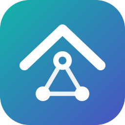

# AIGW OS brand

**AIGW OS: the AI-powered operating system for home gateways.**

## Name

- Write it **AIGW OS**: capitals, one space. Not "Aigw", "AIGW-OS" or "AigwOS".
- Say it letter by letter: "A-I-G-W O-S".
- **AIGW** alone is fine on second mention, in tight spaces and in code.
- Packages, commands and paths keep the short name `aigw` (`opkg install aigw`, `/etc/config/aigw`, `agctl`).

## The mark

A roof over a small network: **the home, with a mind of its own**. The centre node is the brain (`agd`); the two below it are the devices it looks after.

| File | Use |
|------|-----|
| [`logo.svg`](logo.svg) | Mark and wordmark, on light backgrounds |
| [`logo-dark.svg`](logo-dark.svg) | Mark and wordmark, on dark backgrounds |
| [`logo-mark.svg`](logo-mark.svg) | The mark alone: icons, favicons, avatars, LuCI |
| [`social-preview.png`](social-preview.png) | 1280×640 card for GitHub and link previews (source: [`social-preview.html`](social-preview.html)) |

- Leave clear space around the mark of at least a quarter of its width.
- Don't recolour, rotate, stretch or outline it, and don't put the wordmark without the mark in a logo position.
- The mark works down to 16 px.

## Colours

| | Hex | Use |
|-|-----|-----|
| Teal | `#12B5A9` | Mark gradient start |
| Indigo | `#4A53C2` | Mark gradient end, links, badges |
| Deep teal | `#0B8F87` | "OS" on light backgrounds, badges |
| Ink | `#13222A` | Wordmark on light backgrounds |
| Mist | `#EAF2F4` | Wordmark on dark backgrounds |
| Night | `#0B1418` | Dark backgrounds |

The gradient always runs teal (top left) to indigo (bottom right).

## Type

IBM Plex Sans, bold for the wordmark and headings (falls back to Segoe UI, Helvetica or Arial). IBM Plex Mono for code.

## Voice

Plain and calm. Say what the gateway saw and what it did, in words a household understands: "the TV is talking to an ad server", not "anomalous egress flow".
