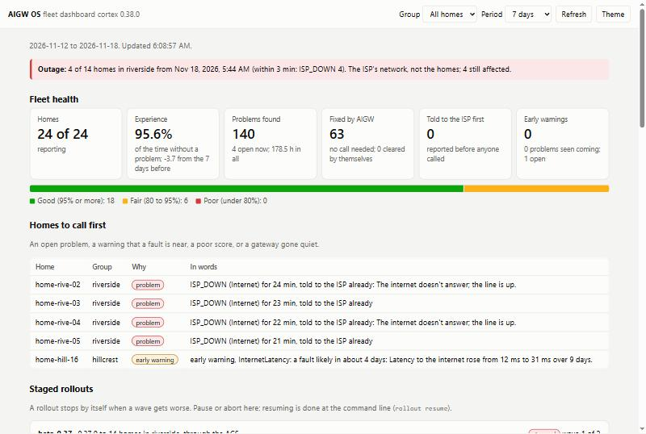

# The operator dashboard

cortex already knows a lot about the fleet: each home's experience score, the
problems AIGW found and fixed, its early warnings, outages across a town,
signals for the sales and care teams, and the staged firmware rollouts. The
dashboard puts all of that on one web page, so an ISP can see what AIGW does
in the first five minutes of a trial.



(The homes and numbers in the picture are made up.)

```bash
cd aigw/cortex
python3 -m aigw_cortex dashboard                 # http://127.0.0.1:8090/
```

To see it without gateways, `python3 -m aigw_cortex demo` serves it with a
simulated fleet of 24 homes from a temporary directory, labelled "Demo data"
([try it](try-it.md)).

It reads the same database as `serve`, so run it on the cortex machine, next
to `serve`. It needs only Python 3: plain HTML, CSS and JavaScript come with
the package. There is no build step, and nothing is loaded from the internet,
so it works on an ISP's own servers with no way out.

## What it shows

| Section | |
|---|---|
| Fleet health | Homes reporting and silent. The average experience score (the share of the time without a problem) and its change from the period before. Problems found, fixed by AIGW (no call needed), cleared by themselves, and told to the ISP before anyone called. Early warnings. A bar of good (95% or more), fair (80 to 95) and poor homes. An outage, when problems start in many homes of one group within minutes, is shown above it in red: the ISP's network, not the homes. This is the [fleet report](fleet-report.md). |
| Homes to call first | Open problems, warnings that a fault is near, poor scores and gateways gone quiet, each with the reason in words. |
| Staged rollouts | Each [rollout](staged-rollout.md): its state, every wave (how many homes kept the firmware or got worse, the score before and after), and why it stopped or waits. The log of what happened. **Pause** and **Abort** buttons. |
| ISP tickets (v0.42) | Whether area outages and proactive tickets reach the ISP's own ticketing ([TMF621 or webhooks](isp-ticketing.md)): on or off, dry run, open and resolved, synced, waiting to go, failed, the last error and the tickets with errors. Each outage and open proactive ticket shows its ISP ticket id and sync state. |
| ISP signals | How many homes would take a faster plan, mesh Wi-Fi or smart queueing, need a line repair, or may leave, and the list in the order a team calls ([ISP signals](isp-signals.md)). |
| Smart queueing and calls first | How many homes have [smart queueing](smart-queueing.md) on, waiting for approval, or tried and undone, from each home's decisions. [Calls-first](calls-first.md) results across the fleet, when a bridge reports them (bridges up to 0.38 don't yet: then the page says so). |
| Gateways | Every gateway: group, AIGW OS version, when it was last heard from, its score this week, devices, alerts, and decisions waiting for approval. Click one (or a home on any list) for its details. |
| One gateway | Its status, the open problem and early warning with the advice, the decisions waiting for approval, alerts, other decisions, and cortex's suggestions to it. Read only: approving stays on the gateway (`agctl approve`, the home's app, Home Assistant). |

Choose a group (an exchange, a town) and a period (1, 7 or 30 days) at the
top. The page refreshes every minute. **Theme** switches between light and
dark; by default it follows the computer's setting.

## Pausing and aborting a rollout

Pause stops new homes from starting; results still count, and can still stop
the rollout. Abort ends it: no more homes get the firmware. Both ask why, and
the reason goes into the rollout's log with "a person (dashboard)". Both need
the dashboard's token (see below).

Resuming is done at the command line, as before:

```bash
python3 -m aigw_cortex rollout resume spring-0.38 "fixed the DNS server"
```

## Access

| Listening on | Reading | Pausing or aborting |
|---|---|---|
| 127.0.0.1 (the default), ::1, localhost | no token needed | token |
| any other address | token | token |

The token is made the first time the dashboard starts, in the cortex data
directory: `dashboard.token`, readable only by its owner. `--token-file`
puts it somewhere else. At start the dashboard prints a link that carries
the token after `#`:

```
dashboard on http://127.0.0.1:8090/ (reading needs no token here)
  with the token (needed to pause or abort a rollout): http://127.0.0.1:8090/#token=...
```

The part after `#` never leaves the browser. The page keeps the token for
that tab only and takes it off the address bar. Without it, the page asks
for the token when it needs it.

To reach the dashboard from other machines, bind it elsewhere and use HTTPS:

```bash
python3 -m aigw_cortex dashboard --listen 0.0.0.0:8090 --cert cert.pem --key key.pem
```

or keep it on 127.0.0.1 behind your own reverse proxy (nginx, Caddy) with
HTTPS and your sign-in, and send the token through it. To make a new token,
delete `dashboard.token` and start the dashboard again.

Some safety details:

- On localhost, reading without a token is allowed only when the browser asks
  for `127.0.0.1`, `localhost` or `::1`. A web page elsewhere can't read the
  dashboard by pointing its own domain name at 127.0.0.1 (DNS rebinding).
- Changes need the token in an `Authorization` header, which another site's
  page can't send. There are no cookies.
- Everything a gateway sends (names, reasons, summaries) is put on the page as
  text, never as HTML. The page's Content Security Policy allows only its own
  script and style, and the JSON escapes `<`, `>` and `&`.

## Privacy

The same rule as the fleet report: no device names unless the home allows
them. The bridge already keeps device names, addresses and the reasons that
quote them at home unless its setting is `devices names`. The dashboard
checks again: for a home whose last report has no named devices, it drops
any device name, address or reason, shows a device action's target as
"a device", and leaves out a Wi-Fi problem's summary, which can name a
device. What an alert was about (a domain) is governed by the bridge's
`alert_names`. Rollouts show counts, never homes' names. The gateway's own
details say which sharing applies: device names shared, devices anonymous,
or no devices shared.

## For developers

`cortex/aigw_cortex/dashboard.py` serves the page and these JSON endpoints
(all GET unless noted):

| Path | |
|---|---|
| `/api/overview?days=7&group=G` | The fleet report, with each call-first home's reason in words (`words`), `queueing` (smart queueing and calls-first counts), `groups` and `version`. |
| `/api/rollouts` | Every rollout (newest 50): state, waves, counts, the last 20 log lines, what it can do now (`can`). |
| `POST /api/rollouts/<name>/pause` or `/abort` | Body `{"reason": "..."}`. Needs the token. 400 without a reason, 409 when the rollout can't (already paused, stopped, done). `/resume` is refused (403). |
| `/api/tickets?open=1` | (v0.42) The ISP ticketing's sync state and each ticket: externalId, the ISP's id and status, sync, error ([isp-ticketing.md](isp-ticketing.md)). |
| `/api/gateways` | One line per gateway. |
| `/api/gateways/<id or name>` | One gateway's details, as above. |

The page is `cortex/aigw_cortex/static/` (`dashboard.html`, `.css`, `.js`).
Tested in `tests/test_cortex.py` (the endpoints, the token on reads and
writes, DNS rebinding, escaping, and the privacy rule).
